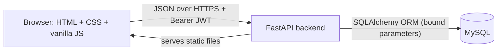

# Architecture

- **One service, two jobs.** FastAPI serves the API under `/api/...` and also the `frontend/` folder, so the browser needs no CORS and one deployment is enough.
- **Layers in `backend/app/`:** `routers/` (HTTP endpoints) -> `crud*.py` (database logic) -> `models.py` (tables). `schemas*.py` validate input and shape output. `security.py` has password hashing, JWT and the role guards. `ratelimit.py` limits login and register attempts.
- **Authentication:** login returns a JWT (HS256, 30 minutes). The browser sends it as `Authorization: Bearer ...`.
- **Authorization:** each endpoint depends on `require_customer`, `require_provider` or `require_admin`. The role is read from the database, never trusted from the token. Request and chat endpoints return 404 to anyone who is not part of that request.
- **Privacy:** search and public profiles never contain email or phone. Contact details appear to both sides only after the provider accepts.
- **Frontend:** plain pages (`index`, `login`, `register`, `dashboard`, `search`, `provider`, `requests`, `messages`, `profile`, `admin`) sharing `js/app.js`. All user text is displayed with `textContent` (no XSS).
