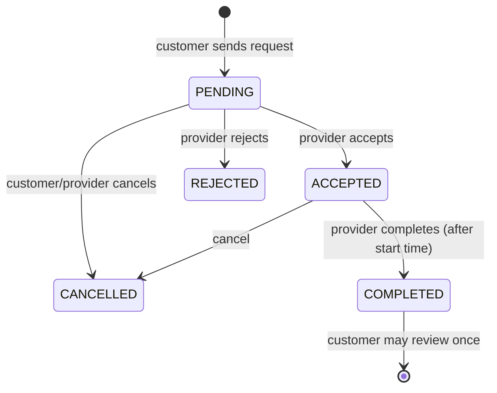

# ER Diagram

GitHub draws this diagram automatically.

```mermaid
erDiagram
    LOCATIONS ||--o{ USERS : "lives in"
    LOCATIONS ||--o{ SERVICE_REQUESTS : "service at"
    USERS ||--o| PROVIDER_PROFILES : "has (providers only)"
    PROVIDER_PROFILES ||--o{ PROVIDER_SKILLS : offers
    SKILLS ||--o{ PROVIDER_SKILLS : "offered as"
    CATEGORIES ||--o{ SKILLS : groups
    PROVIDER_PROFILES ||--o{ AVAILABILITY : "free on"
    USERS ||--o{ SERVICE_REQUESTS : "sends (customer)"
    USERS ||--o{ SERVICE_REQUESTS : "receives (provider)"
    SKILLS ||--o{ SERVICE_REQUESTS : "needed for"
    SERVICE_REQUESTS ||--o{ MESSAGES : "has chat"
    USERS ||--o{ MESSAGES : writes
    SERVICE_REQUESTS ||--o| REVIEWS : "reviewed once"
    USERS ||--o{ REVIEWS : "writes (customer)"
    USERS ||--o{ REVIEWS : "receives (provider)"

    USERS { int id PK string email UK string password_hash enum role int location_id FK }
    LOCATIONS { int id PK string city string area string pincode }
    PROVIDER_PROFILES { int id PK int user_id FK text description int experience_years enum service_mode }
    CATEGORIES { int id PK string name UK }
    SKILLS { int id PK int category_id FK string name UK int created_by_id FK }
    PROVIDER_SKILLS { int id PK int provider_profile_id FK int skill_id FK }
    AVAILABILITY { int id PK int provider_profile_id FK enum day_of_week time start_time time end_time }
    SERVICE_REQUESTS { int id PK int customer_id FK int provider_id FK int skill_id FK enum service_mode enum status datetime scheduled_at }
    MESSAGES { int id PK int service_request_id FK int sender_id FK text body }
    REVIEWS { int id PK int service_request_id FK_UK int reviewer_id FK int provider_id FK int rating }
```

## Request status flow


